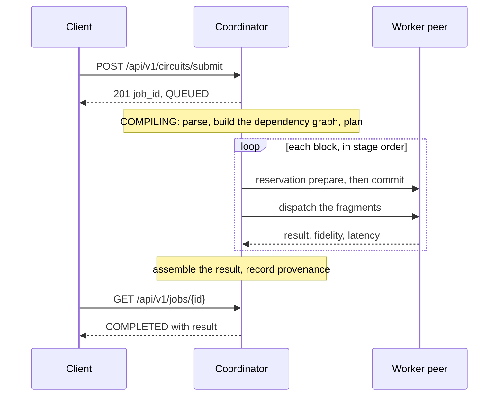

QMesh has three kinds of process: a **coordinator**, **worker peers** and an **operator console**. They share two
stores: MongoDB for durable state and an append-only peer log on disk.

## The parts

| Part | What it does | Built with |
| --- | --- | --- |
| Coordinator | Serves the HTTP API, parses and plans circuits, reserves peers, dispatches fragments, assembles results and records provenance. | Python, FastAPI |
| Worker peers | Advertise the services they offer, accept reservations and execute the fragments sent to them. | py-libp2p, Qiskit |
| Operator console | Shows the network, runs and results. The browser never calls the backend directly: the console's server routes proxy every request. | Next.js |
| MongoDB | Jobs, execution plans, peer projections, reservation and execution events, provenance bundles. | |
| Peer log | An append-only JSONL file, flushed with `fsync` by default, kept by the coordinator. | |

<Callout>
  The x402 payment gateway runs inside the **console's** server routes, not in the coordinator. It forwards paid
  requests to hidden internal coordinator routes protected by a shared secret. See
  [x402 payments](/docs/guides/x402-payments).
</Callout>

## How a circuit run flows

1. **Submit.** The API stores a job as `QUEUED` and returns its id. The rest runs in the background.
2. **Plan.** The coordinator waits up to 10 seconds for service peers to appear, then compiles an execution plan.
   See [Circuit planning](/docs/concepts/circuit-planning).
3. **Reserve and run.** For each block in the plan, in order, the coordinator reserves a peer and sends it the
   fragments. See [Reservations](/docs/concepts/reservations).
4. **Assemble.** The coordinator builds the final result, records a provenance bundle and marks the job
   `COMPLETED`. See [Provenance](/docs/concepts/provenance).

The five-layer picture on the [Introduction](/docs) groups these steps by responsibility.

## Where state lives

- **Job state** is stored as one run record per job, updated as the job moves through its states
  ([Jobs](/docs/concepts/jobs)).
- **Reservations and executions** are event-sourced: every transition is an appended event, and the current state
  is rebuilt from the events.
- **Peers** are held in the coordinator's in-memory registry, fed by discovery messages, with projections stored in
  MongoDB ([Peers and discovery](/docs/concepts/peers)).

## What this architecture does not give you

There is one coordinator. QMesh does not run multiple coordinators or a consensus protocol between them, and the
embedded workers used in local development share the coordinator's process. See [Scope](/docs/scope).
