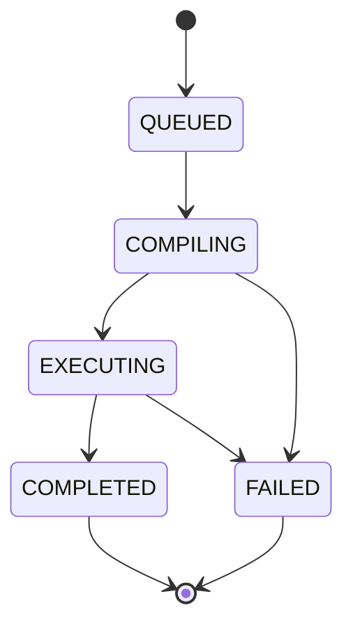

Every circuit you submit becomes a **job**. A job is a stored record that the coordinator updates as the work
advances, so you can poll it at any time.

## States

| State | Meaning |
| --- | --- |
| `QUEUED` | The job is stored and waiting for a background worker. This is the status the submit call returns. |
| `COMPILING` | The coordinator is waiting for service peers, parsing the circuit and building the execution plan. |
| `EXECUTING` | The plan exists and fragments are being run. `progress` reports how many have finished. |
| `COMPLETED` | Every block ran. The result and the provenance bundle id are available. |
| `FAILED` | Something went wrong. The `error` field says what. |

`COMPLETED` and `FAILED` are terminal: the coordinator ignores a job that is already in either state.

## What a job record holds

`GET /api/v1/jobs/{job_id}` returns:

| Field | Description |
| --- | --- |
| `job_id`, `status` | The identifier and the current state. |
| `plan_id` | Set once the plan exists. Fetch it with `GET /api/v1/plans/{plan_id}`. |
| `progress` | `total_fragments`, `completed_fragments`, `active_fragments`, `completion_ratio`, `finalizing`. `null` until the plan exists. |
| `result` | `fragment_results` (one entry per fragment, including which peer ran it) and `quantum_result`. `null` until `COMPLETED`. |
| `error` | The failure message when the job is `FAILED`, otherwise `null`. |
| `circuit_text` | The circuit as submitted. |
| `provenance_bundle_id` | The id to pass to the verification endpoint. |
| `created_at`, `updated_at` | Timestamps. |

`finalizing` is `true` when no fragment is still running but the job has not yet finished assembling the final
result.

## Who can see a job

A job belongs to the user who submitted it. Listing and reading return only your own jobs, unless your account
has the admin role. A job you cannot see answers `404`, the same as one that does not exist.

## Failure

A job fails when any step raises: the circuit cannot be parsed, no peer offers a service the plan needs, or a
block fails on every peer it was assigned (see [Reservations](/docs/concepts/reservations)). The `error` field
carries the message, for example `Execution block block-s01-b01 failed across all assigned peers`, followed by
the last peer error. Fragments that finished before the failure are kept on the stored record, but `result`
stays `null`.

## Credits

Credit metering is **off by default**. It turns on when `QB2_CIRCUIT_JOB_CREDIT_COST` is greater than zero (the
default is `0`). With it on, submitting a job **holds** that many credits first, and the hold is settled when the
job ends: charged if the job `COMPLETED`, not charged otherwise. A submit with too few credits answers
`402 Payment Required` and creates no job.

Jobs paid through [x402](/docs/guides/x402-payments) are paid per request instead and bypass this meter.
