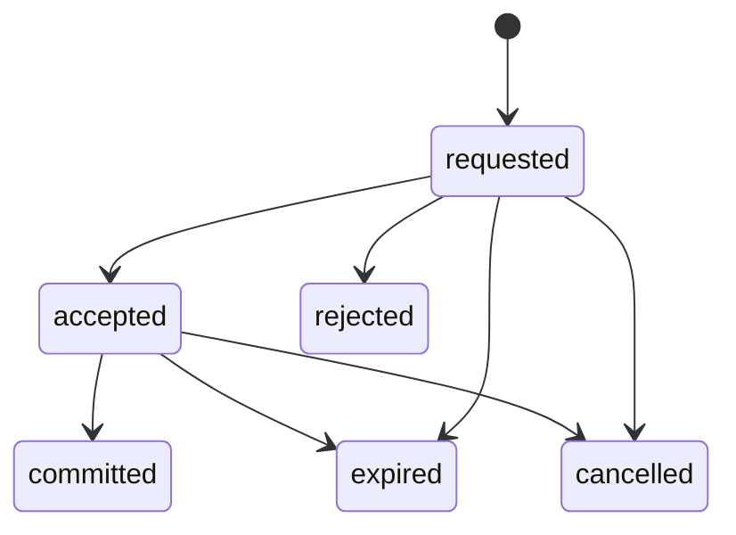

A peer can only run so much at once, and it may refuse. So the coordinator never sends fragments blindly: it first
**reserves** the peer, and only a committed reservation is followed by a dispatch.

## The protocol

Reservations travel over libp2p streams. Their protocol ids are derived from the rendezvous namespace
(default `quantum-backend`):

| Step | Protocol id |
| --- | --- |
| Prepare | `/qb2/quantum-backend/reservation/prepare/1.0.0` |
| Commit | `/qb2/quantum-backend/reservation/commit/1.0.0` |
| Cancel | `/qb2/quantum-backend/reservation/cancel/1.0.0` |
| Dispatch fragments | `/qb2/quantum-backend/execution/fragment-dispatch/1.0.0` |

For each block, the coordinator sends a **prepare** request that states the service, the estimated number of
qubits and the estimated circuit depth. The peer answers with its decision: accept, or decline with a reason.

## States

`committed`, `cancelled`, `expired` and `rejected` are terminal. A reservation has a time to live
(`ttl_seconds`, 60 by default and at least 5). If it is not committed in time it can expire.

The state of a reservation is not stored as a single value. Each transition is appended as an event, and the
current state is rebuilt from the events. `GET /api/v1/reservations/{reservation_id}` returns that rebuilt state.

## What the coordinator does for one block

1. Pick the next candidate peer: the primary first, then up to three fallbacks, in the order the
   [plan](/docs/concepts/circuit-planning) ranked them.
2. Send **prepare**. If the peer does not accept, record a rejection and move to the next candidate.
3. Send **commit**. If it does not return `committed`, send **cancel**, record the cancellation and move on.
4. Send the fragments with **dispatch**.
5. If the peer reports a failed execution, record the failure and move to the next candidate.
6. If the peer completes, record its fidelity and latency and continue to the next block.

When every candidate has failed, the block fails and so does the job:
`Execution block <id> failed across all assigned peers`. Each fragment result records the number of `attempts`
it took.

## API

The coordinator drives reservations itself during a job. The endpoints below are for inspection and tooling.

| Endpoint | Purpose |
| --- | --- |
| `POST /api/v1/reservations` | Request a reservation. Takes `workflow_run_id`, `fragment_id`, `service_id`, optional `requesting_peer_id`, `ttl_seconds` and an `idempotency_key`. |
| `GET /api/v1/reservations/{reservation_id}` | Read the current state. |
| `POST /api/v1/reservations/{reservation_id}/cancel` | Cancel a reservation. |

An `idempotency_key` makes a repeated request safe to retry: a request with a key that was already used returns the existing reservation instead of creating another.
