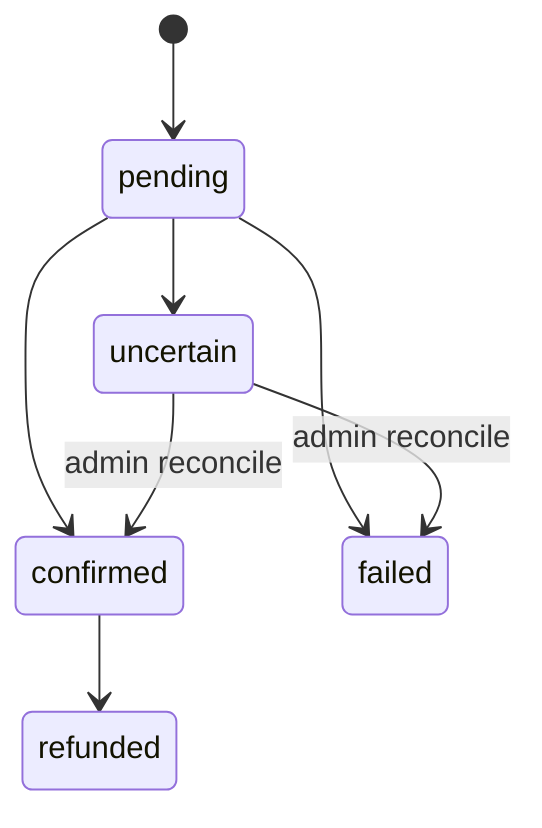

Every payment rail (x402, cards, stablecoins, on-chain transfers) records the same kind of **payment event**, and value
that becomes credits is written to a single **append-only, USDC-denominated ledger**. The goal is "accept anywhere, settle
once": idempotency, reconciliation and double-payment protection exist once, not once per rail. It was added in
[#79](https://github.com/QMeshPy/distributed-quantum/pull/79).

## Four collections

| Collection | Holds | Unique on |
| --- | --- | --- |
| `payment_events` | One document per payment, with its status history | `idempotency_key` |
| `credit_ledger` | Append-only entries: `credit`, `hold`, `capture`, `release` | `idempotency_key` |
| `credit_holds` | A guard: how much of a hold can still be captured or released | `hold_id` |
| `credit_balances` | A guard: cached `available` and `held` per account | `account_id` |

Money is stored as `Decimal128`, never as a float.

## Payment events

Replaying an idempotency key returns the stored event. Replaying it with a different rail, purpose, asset, amount or
account is an error. An event moves through these states:



- **Confirming** an event credits its ledger account, and confirming twice is harmless: it finishes a credit a crash
  interrupted.
- **Uncertain** is for a payment whose outcome is unknown, for example a timeout after a transaction may have been
  broadcast. An uncertain payment is **never retried automatically**. An administrator resolves it after checking the rail.
- Keys name the payment itself, so a retry makes the same key: `stripe:checkout:<session id>` for a credit pack, or
  `fragment_payout:<proposal id>:<fragment id>:<attempt>` for a proposal payout, or `worker_payout:<batch id>` for a worker
  payout batch.

## The credit ledger

Entries are never updated or deleted. A balance is derived by adding them up: a credit adds to `available`, a **hold** moves
value from `available` to `held`, a **capture** spends held value, and a **release** gives it back.

```text
submit a job  ->  hold the cost
job completes ->  capture it
job fails     ->  release it, less what its workers earned for finished fragments
```

MongoDB here is a standalone server without multi-document transactions. So each hold, capture or release changes its
guard document with one atomic conditional update (a hold succeeds only if `available >= amount`), and the entry's unique
key decides between concurrent replays. Writes are ordered so a crash **fails closed**: value can end up reserved until
reconciled, but it is never spendable twice.

## Paying workers

Workers who run a circuit job's fragments are paid **per fragment**, as results are recorded, from the job's credit hold.
The money leaves in batched USDC transfers. This was added in [#104](https://github.com/QMeshPy/distributed-quantum/pull/104) and closes [#8](https://github.com/QMeshPy/distributed-quantum/issues/8). It needs
`QB2_CIRCUIT_JOB_CREDIT_COST` above `0`, because that hold is the budget. With metering off, workers are not paid.

```text
a fragment result is recorded
  -> one payout intent per fragment, ever      (priced from the worker's registered price, reserved against the job's hold)
  -> the settler: a worker's intents reach the threshold, or the oldest one reaches the maximum age
  -> one USDC transfer from the payout wallet  (payment event worker_payout:<batch id>)
  -> the receipt is verified on-chain          -> the intents are paid and the worker's total earned grows
```

- **Who is paid.** A fragment result names the libp2p peer that ran it. That peer's enrollment owner is the worker, and the
  owner's registered pricing supplies the price and the payout wallet. A peer can only be enrolled once, so registering
  pricing cannot redirect another worker's payouts.
- **Price.** One fragment is one operation. Its price is the worker's registered price for that operation type, for
  example `hadamard` or `cnot`, or their `custom` price. Prices are cut to whole micro-USDC (six decimals) before they are
  reserved, so the amount reserved, sent and verified on-chain is the same.
- **Exactly once.** An intent's unique key is the job and the fragment. Processing a job again, or recording the same
  fragment twice at once, stores one intent, reserves the budget once and changes reputation once.
- **Budget.** The first intent for a job copies the job's credit hold into a guard. Each intent is reserved with one atomic
  conditional update, so concurrent fragments can never commit more than the hold. A job without a hold, which means
  metering is off or the run was paid by [x402](/docs/integrations/x402), records its intents as `no_budget` and pays
  nothing. When a job fails, the credit meter captures what its workers earned and releases only the rest, so the user pays
  for finished work and nothing else.

A fragment that is **withheld** is recorded with an amount of `0` and a reason, and is never paid:

| Reason | When | Reputation |
| --- | --- | --- |
| `fragment_failed` | The fragment's result is not a success | -5 |
| `fidelity_rejected` | Observed fidelity is below `QB2_WORKER_PAYOUT_MIN_FIDELITY` | -5 |
| `job_failed` | The job failed before this fragment ran | unchanged |
| `unknown_worker` | The peer is not enrolled, or its owner has no pricing or wallet | unchanged |
| `unpriced` | There is no positive price for the operation | unchanged |
| `no_budget`, `over_budget` | The job has no credit hold, or the hold is used up | +2 |

A paid fragment adds +2. Reputation is kept between 0 and 100, and a worker whose reputation falls below 20 is deactivated.

### Settlement

An intent moves `accrued`, then `settling`, then `submitted`, then `paid`. The settler only runs when
`QB2_WORKER_PAYOUT_WALLET` names a platform-managed wallet. Otherwise intents accrue and nothing is sent. The payout wallet
must hold Base Sepolia USDC and a little ETH for gas.

A batch moves through `claiming`, `sending`, `submitted` and `finishing` to `paid`, or ends as `failed` (its intents return
to `accrued`) or `uncertain`. Each move is a conditional update on the current status, so with several backend instances a
batch is sent, confirmed and added to the worker's total once.

- A send that fails validation, with nothing broadcast, returns the batch's intents to `accrued` for the next run.
- Any other send error leaves the batch `uncertain` and its intents `settling`. They are **never sent again
  automatically**. Resolve the batch's `worker_payout:<batch id>` event with the admin reconcile route. On the next sweep
  the settler then pays the intents (confirmed) or returns them for a new send (failed).
- A submitted batch counts as paid only when the transaction confirms a USDC transfer of the batch amount from the payout
  wallet to the worker. A reverted transaction returns the intents to `accrued`. A confirmed transaction that does not
  contain that transfer marks the batch `uncertain`. Its event is already confirmed, so it cannot be reconciled and needs a
  manual investigation.
- Every sweep first picks up batches a stopped settler left behind: a `finishing` batch gets the outcome that was already
  decided, and a `claiming` or `sending` batch untouched for 15 minutes is checked against its payment event, so nothing is
  sent twice.

| Variable | Default | Purpose |
| --- | --- | --- |
| `QB2_WORKER_PAYOUT_WALLET` | unset | The platform wallet that sends payouts. Unset means accrue only. |
| `QB2_WORKER_PAYOUT_THRESHOLD` | `1` | Send once a worker's accrued USDC reaches this. |
| `QB2_WORKER_PAYOUT_MAX_AGE_SECONDS` | `86400` | Or once their oldest unpaid fragment is this old. |
| `QB2_WORKER_PAYOUT_INTERVAL_SECONDS` | `300` | How often the settler runs. `0` turns sending off. |
| `QB2_WORKER_PAYOUT_MIN_FIDELITY` | `0` | Fragments below this observed fidelity are not paid. |

Three more collections hold the work: `payout_intents` (one per fragment), `payout_budgets` (the guard for a job's hold) and
`payout_batches` (one per transfer). Two routes read the result: `GET /api/v1/jobs/{job_id}/payouts` returns a job's budget,
committed, paid and pending totals with every fragment's intent and status or withheld reason (the job's owner or an admin),
and `GET /api/v1/marketplace/worker/{worker_id}/earnings` adds pending earnings and the counts of paid and withheld
fragments. To earn from a [mesh of your own laptops](/docs/mesh/overview), a worker's peer must be enrolled with pricing.

## Reconciliation

A sweep runs every `QB2_PAYMENT_RECONCILE_INTERVAL_SECONDS` (default `300`, `0` disables it) and on demand. It marks
pending events older than 30 minutes that have no external reference as uncertain, and it compares each account's cached
balance with the sum of its ledger entries and **reports** any drift. It does not repair drift, so an operator can find
the cause first.

## Admin API

All routes need the admin role, and none can write ledger entries.

| Method and path | Purpose |
| --- | --- |
| `GET /api/v1/admin/payments/events` | List events. Filters: `status`, `job_id`, `proposal_id`, `limit` |
| `GET /api/v1/admin/payments/events/{key}` | One event with its status history |
| `POST /api/v1/admin/payments/events/{key}/reconcile` | Resolve a pending or uncertain event as `confirmed` or `failed`, with a reason |
| `POST /api/v1/admin/payments/reconciliation` | Run the sweep now |
| `GET /api/v1/admin/payments/accounts/{account_id}/balance` | A balance derived from the ledger |

Users read their own balance at `GET /api/v1/credits/balance`. See [Billing](/docs/integrations/billing) for how credits are
bought and spent.
