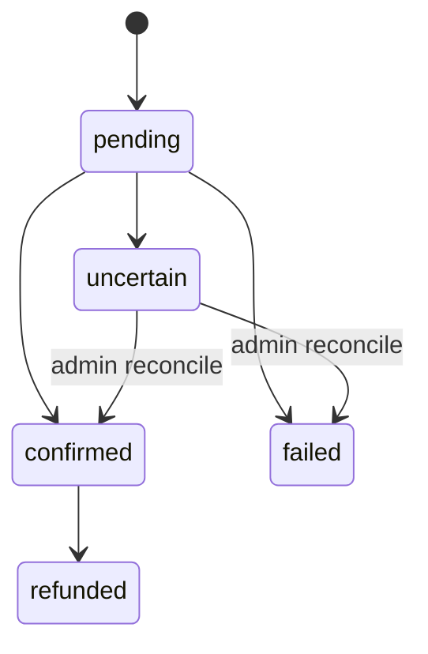

Every payment rail (x402, cards, stablecoins, on-chain transfers) records the same kind of **payment event**, and value
that becomes credits is written to a single **append-only, USDC-denominated ledger**. The goal is "accept anywhere, settle
once": idempotency, reconciliation and double-payment protection exist once, not once per rail. It was added in
[#79](https://github.com/QMeshPy/distributed-quantum/pull/79).

## Four collections

| Collection | Holds | Unique on |
| --- | --- | --- |
| `payment_events` | One document per payment, with its status history | `idempotency_key` |
| `credit_ledger` | Append-only entries: `credit`, `hold`, `capture`, `release` | `idempotency_key` |
| `credit_holds` | A guard: how much of a hold can still be captured or released | `hold_id` |
| `credit_balances` | A guard: cached `available` and `held` per account | `account_id` |

Money is stored as `Decimal128`, never as a float.

## Payment events

Replaying an idempotency key returns the stored event. Replaying it with a different rail, purpose, asset, amount or
account is an error. An event moves through these states:



- **Confirming** an event credits its ledger account, and confirming twice is harmless: it finishes a credit a crash
  interrupted.
- **Uncertain** is for a payment whose outcome is unknown, for example a timeout after a transaction may have been
  broadcast. An uncertain payment is **never retried automatically**. An administrator resolves it after checking the rail.
- Keys name the payment itself, so a retry makes the same key: `stripe:checkout:<session id>` for a credit pack, or
  `fragment_payout:<proposal id>:<fragment id>:<attempt>` for a payout.

## The credit ledger

Entries are never updated or deleted. A balance is derived by adding them up: a credit adds to `available`, a **hold** moves
value from `available` to `held`, a **capture** spends held value, and a **release** gives it back.

```text
submit a job  ->  hold the cost
job completes ->  capture it
job fails     ->  release it
```

MongoDB here is a standalone server without multi-document transactions. So each hold, capture or release changes its
guard document with one atomic conditional update (a hold succeeds only if `available >= amount`), and the entry's unique
key decides between concurrent replays. Writes are ordered so a crash **fails closed**: value can end up reserved until
reconciled, but it is never spendable twice.

## Reconciliation

A sweep runs every `QB2_PAYMENT_RECONCILE_INTERVAL_SECONDS` (default `300`, `0` disables it) and on demand. It marks
pending events older than 30 minutes that have no external reference as uncertain, and it compares each account's cached
balance with the sum of its ledger entries and **reports** any drift. It does not repair drift, so an operator can find
the cause first.

## Admin API

All routes need the admin role, and none can write ledger entries.

| Method and path | Purpose |
| --- | --- |
| `GET /api/v1/admin/payments/events` | List events. Filters: `status`, `job_id`, `proposal_id`, `limit` |
| `GET /api/v1/admin/payments/events/{key}` | One event with its status history |
| `POST /api/v1/admin/payments/events/{key}/reconcile` | Resolve a pending or uncertain event as `confirmed` or `failed`, with a reason |
| `POST /api/v1/admin/payments/reconciliation` | Run the sweep now |
| `GET /api/v1/admin/payments/accounts/{account_id}/balance` | A balance derived from the ledger |

Users read their own balance at `GET /api/v1/credits/balance`. See [Billing](/docs/integrations/billing) for how credits are
bought and spent.
