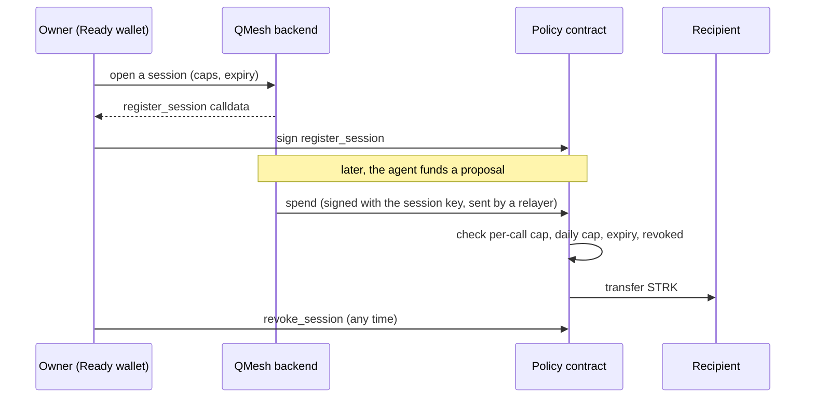

An agent that can spend money needs a limit that does not depend on the agent, or on QMesh's servers, behaving. On
**Starknet Sepolia** (testnet only), QMesh puts that limit in a Cairo contract. It arrived in
[#101](https://github.com/QMeshPy/distributed-quantum/pull/101) and was extended by
[#118](https://github.com/QMeshPy/distributed-quantum/pull/118).

<Iso scene="starknet" />

## The idea

The **owner** (a person with a Ready wallet) registers a **session** for an agent. The session has a public key, a
per-call cap, a rolling daily cap, an expiry and a recipient. The agent holds the matching session key and can only ask the
contract to `spend`. The contract rejects any spend over the caps, after expiry, or after the owner revokes the session.



How the console's agent settings map to the contract: `max_per_proposal` is `max_per_call`, and `daily_budget` is
`daily_limit`. The console's defaults are 50 STRK per proposal, 200 STRK per day and 90 days.

## Where the money goes

Agents normally fund proposals in USDC on Base Sepolia. With an **active Starknet session**, funding goes out as **STRK**
from the policy contract to the proposal's `researcher_starknet_wallet`. If the session is active and that wallet is
missing, the funding fails. It does **not** fall back to USDC. Amounts in STRK and USDC are tracked separately and never mixed.

## What is where

- **Contract:** `backend/contracts/starknet/src/spending_policy.cairo`. Per-agent rows, ECDSA session-key `spend`, owner-only
  register and revoke. The owner can also withdraw testnet STRK through **Get STRK**.
- **Backend:** `quantum_backend_v2/starknet/` for keys, policy checks and paymaster support. The session key is encrypted at
  rest with `WALLET_ENCRYPTION_KEY`.
- **Console:** on **Agents**, **Open Starknet Session** connects a Ready wallet with starknetkit. The session card shows the
  caps, status (Active, Revoking, Expired, Revoked), transaction history and **Revoke**.
- **Gas:** the AVNU paymaster may sponsor `register_session` only. Everything else is paid by the Ready wallet or the relayer.

## API

| Method and path | Purpose |
| --- | --- |
| `POST /api/v1/agents/{id}/starknet-session` | Create a session. Returns the `register_session` calldata and an optional paymaster payload. |
| `POST /api/v1/agents/{id}/starknet-session/spend` | Preflight a spend against the caps and return `spend` calldata. |
| `POST /api/v1/agents/{id}/starknet-session/tx` | Record a transaction hash. |
| `POST /api/v1/agents/{id}/starknet-session/txs` | Refresh transaction receipts. |
| `POST /api/v1/agents/{id}/starknet-session/revoke` | Mark the session revoked and return the `revoke_session` calldata. |

These routes need a signed identity assertion for the agent's owner (a `qn1.` bridge token), not an ordinary bearer token.

## Set it up

Prerequisites: Python 3.12 or later, Node 22, a funded Ready wallet on Starknet Sepolia, and Scarb 2.19.0 with starkli and
sncast to build and deploy the contract.

```txt title="backend/.env"
AGENT_AUTH_BRIDGE_SECRET=
WALLET_ENCRYPTION_KEY=
QB2_STARKNET_SEPOLIA_RPC_URL=https://starknet-sepolia-rpc.publicnode.com
STARKNET_POLICY_CONTRACT=
STARKNET_SESSION_KEY_SPEND=1
STARKNET_RELAYER_ADDRESS=
STARKNET_RELAYER_PRIVATE_KEY=
AVNU_PAYMASTER_API_KEY=
```

1. Deploy the policy contract and fund it with testnet STRK. The constructor takes the owner's Ready address.
2. Set the variables above and restart the backend.
3. Open a session from **Agents**, and approve `register_session` in the Ready wallet.

A contract deployed before #118 cannot be upgraded. Agents re-register against the new one. Treat the relayer key like any other
secret: it submits spends but cannot exceed the on-chain caps.

<Callout type="warn">
  Starknet support is **testnet only**. Mainnet is out of scope, and so is proving quantum circuits with STARKs, which is
  research.
</Callout>
