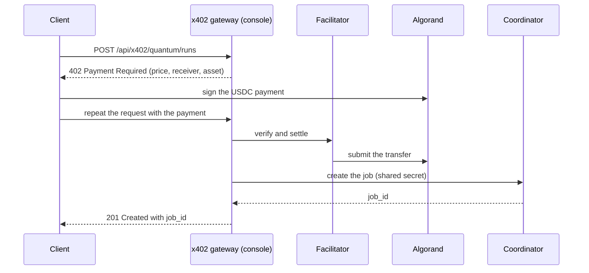

[x402](https://www.x402.org) uses the HTTP `402 Payment Required` status to let a client pay for a request
programmatically. QMesh exposes five paid routes through it. A client asks for a run, learns the price from the
`402` answer, pays in USDC on Algorand, and repeats the request with proof of payment. Only then is a job created.

<Callout type="warn">
  This guide covers **TestNet**. The configuration also accepts `mainnet`, but QMesh is a proof of concept on
  simulators and its payment path has only been exercised on TestNet.
</Callout>

<Iso scene="x402" />

## The routes

| Route | Runs | Default price | Price variable |
| --- | --- | --- | --- |
| `POST /api/x402/quantum/runs` | A circuit, distributed across worker peers. Body: `{"circuit": "<OpenQASM>"}`. | $0.01 | `X402_QUANTUM_RUN_PRICE` |
| `POST /api/x402/options/runs` | Quantum Amplitude Estimation option pricing, with a classical Black-Scholes baseline. | $0.01 | `X402_QUANTUM_RUN_PRICE` |
| `POST /api/x402/risk/runs` | Quantum risk (VaR and CVaR) by iterative amplitude estimation. | $0.05 | `X402_RISK_RUN_PRICE` |
| `POST /api/x402/finance/runs` | Portfolio optimisation of tokenized stocks with QAOA. Analysis only: it never trades. | $0.05 | `X402_FINANCE_RUN_PRICE` |
| `POST /api/x402/pharma/runs` | Drug-discovery docking, kept in a durable, owner-scoped job store. | $0.25 | `X402_PHARMA_RUN_PRICE` |

Prices are flat per call. The circuit and options routes have completed paid calls on Algorand TestNet. The risk, finance
and Pharma routes were added in [#128](https://github.com/QMeshPy/distributed-quantum/pull/128): their unpaid `402` response is tested, and the project's README says a
paid call has **not** been run on them yet. Dynamic pricing and more payment networks are in review as
[#135](https://github.com/QMeshPy/distributed-quantum/pull/135).
The options body takes `option_type` (one of `european_call_short`, `european_call_long`, `expand`, `delay`,
`abandon`, `patent`, `natural_resource`, `financial_flexibility`), `current_value`, `strike_or_cost`,
`time_to_expiry` (years), `volatility` and `risk_free_rate`. All six are required.

Every route answers a paid request with `201 Created`, a `job_id` and the job's initial status. Read the result with
`GET <route>/{jobId}`, for example `GET /api/x402/quantum/runs/{jobId}`. Reading a result is **not** paid, and paid jobs are
never listed: a job can only be read back through its own server-generated `job_id`. An unpaid or invalid call is rejected
with `402` before the backend is contacted, so it creates no job.

## How a paid request flows



The gateway runs in the console's server routes. After a payment settles it calls the coordinator's hidden
internal routes, authenticated with the `X-X402-Gateway-Secret` header. The coordinator stores these jobs under a
fixed service identity (`x402-algorand`) and does not charge them against credits.

## Configure it

The routes are off unless `X402_ENABLED=true`. Until then they answer `503` with
`{"error": "Algorand x402 is not enabled."}`.

```txt title="frontend/.env.local"
X402_ENABLED=true
X402_NETWORK=testnet
X402_AVM_ADDRESS=<your Algorand receiver address>
X402_FACILITATOR_URL=https://facilitator.goplausible.xyz
X402_QUANTUM_RUN_PRICE=0.01
X402_RISK_RUN_PRICE=0.05
X402_FINANCE_RUN_PRICE=0.05
X402_PHARMA_RUN_PRICE=0.25
X402_GATEWAY_SECRET=<openssl rand -hex 32>
```

```txt title="backend/.env"
QB2_X402_GATEWAY_SECRET=<the same value as X402_GATEWAY_SECRET>
```

| Variable | Notes |
| --- | --- |
| `X402_NETWORK` | `testnet` (default) or `mainnet`. Anything else is a configuration error. |
| `X402_AVM_ADDRESS` | Required. A valid Algorand address that receives the payments. Only the public address is needed; never put a mnemonic or private key in this repository. |
| `X402_QUANTUM_RUN_PRICE` | A positive USD amount such as `0.01`, with up to six decimals. A leading dollar sign is accepted too. Defaults to `0.01`. It applies to the circuit and options routes. |
| `X402_RISK_RUN_PRICE`, `X402_FINANCE_RUN_PRICE`, `X402_PHARMA_RUN_PRICE` | The flat price of the risk, finance and Pharma routes, with the same format. They default to `0.05`, `0.05` and `0.25`. |
| `X402_FACILITATOR_URL` | The service that verifies and settles payments. Defaults to `https://facilitator.goplausible.xyz`. |
| `X402_GATEWAY_SECRET` | Required, at least 16 characters. Must equal `QB2_X402_GATEWAY_SECRET` in the backend. |
| `NEXT_PUBLIC_BACKEND_URL` | Where the gateway reaches the coordinator. Defaults to `http://localhost:8081`. |

With a bad value, the route answers `503` with `Algorand x402 configuration is invalid.` and logs the reason on the
server.

The receiver account must be funded and opted in to the USDC asset before it can receive a payment. The payer
needs TestNet USDC and an opt-in too.

## Check the unpaid response

Without a payment, the route should answer `402`:

```bash
curl -i -X POST http://localhost:3000/api/x402/quantum/runs \
  -H "Content-Type: application/json" \
  -d '{"circuit": "OPENQASM 2.0; include \"qelib1.inc\"; qreg q[1]; h q[0];"}'
```

The `402` response carries the price, the network, the receiver and the asset. An x402-capable client reads it,
pays and retries. See the [x402 documentation](https://www.x402.org) for client libraries.

## Discovery

All routes publish x402 Bazaar discovery metadata and carry the `x402-global-challenge` tag, so that
discovery-aware clients and agents can find them and read their input schema.
