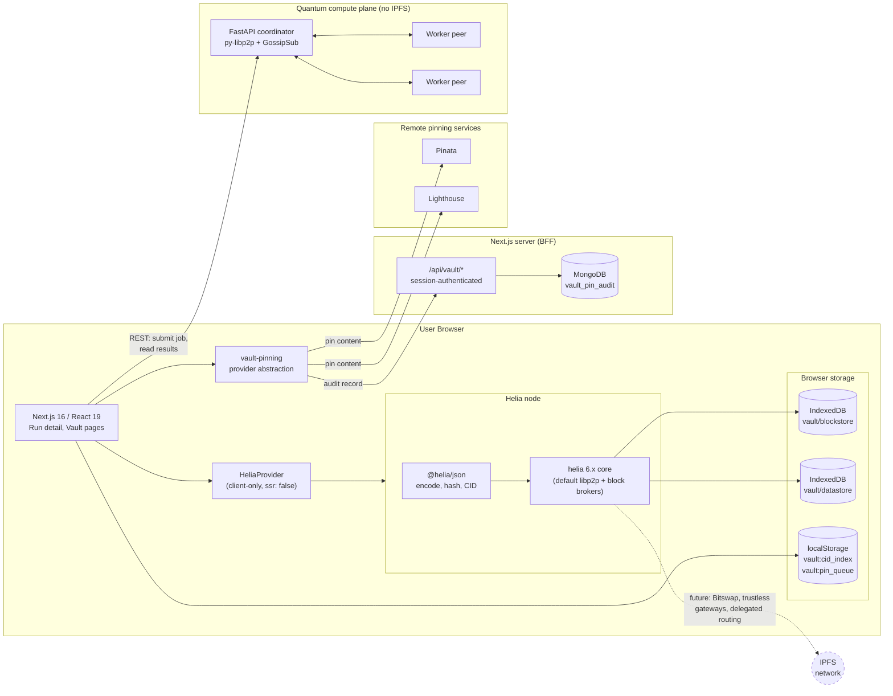
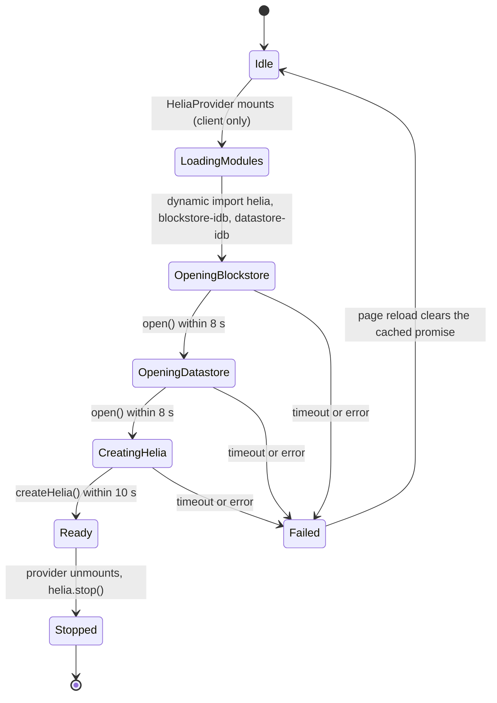
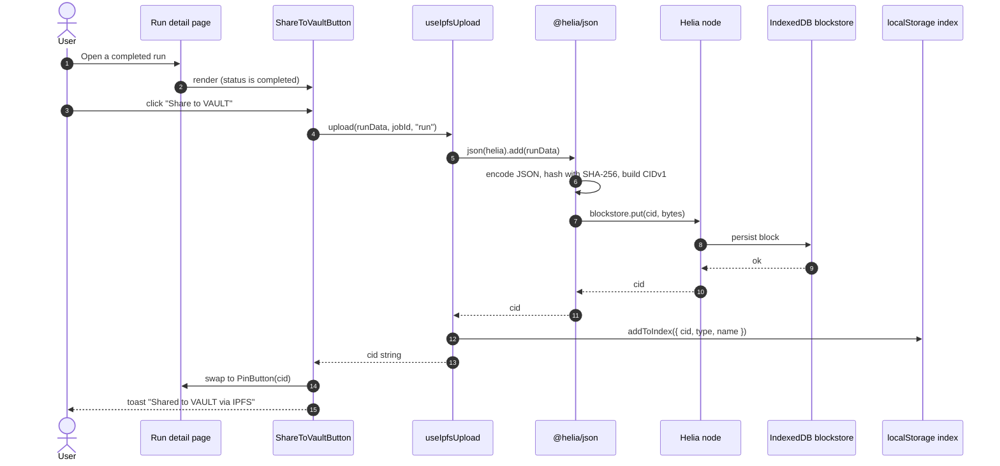
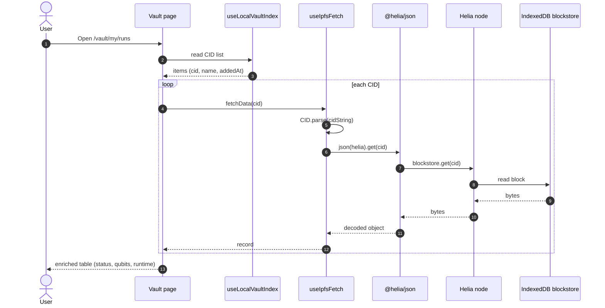
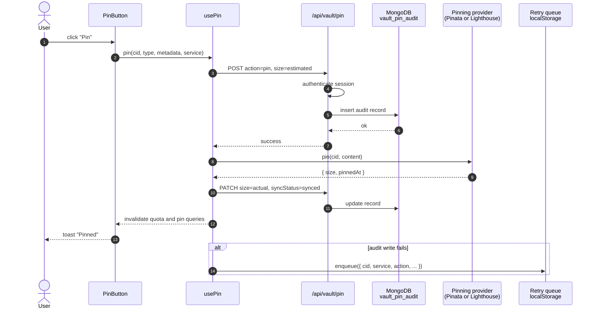
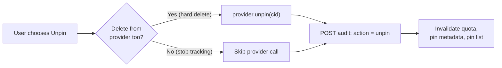
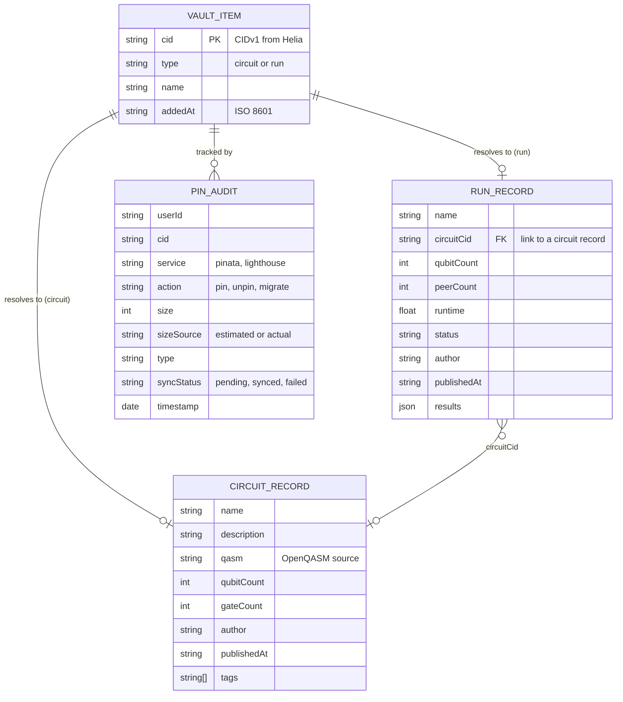
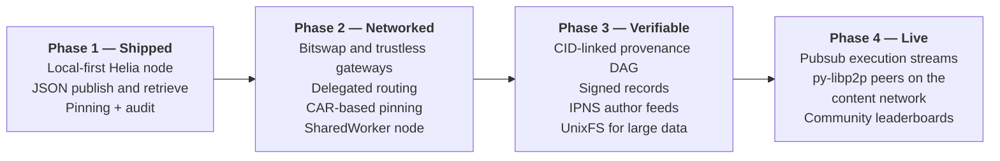
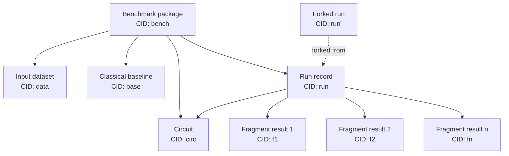
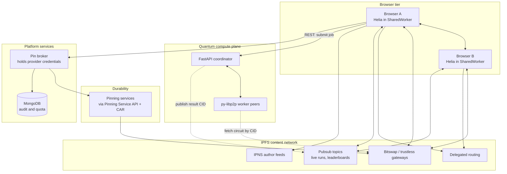

# Helia in Distributed Quantum Services

### Architecture, Data Flows, and Roadmap for a Browser-Native Content-Addressed Layer

|                    |                                                                              |
| ------------------ | ---------------------------------------------------------------------------- |
| **Project**        | Distributed Quantum Services, [QMeshPy/distributed-quantum](https://github.com/QMeshPy/distributed-quantum) |
| **Document**       | Helia integration overview                                                   |
| **Audience**       | Helia / IPFS maintainers and ecosystem engineers                             |
| **Helia versions** | `helia ^6.1.4`, `@helia/json ^5.1.1`, `multiformats ^14.0.0`                 |

---

## Table of Contents

1. [Executive Summary](#1-executive-summary)
2. [Project Context](#2-project-context)
3. [Why Helia](#3-why-helia)
4. [Integration Status at a Glance](#4-integration-status-at-a-glance)
5. [System Architecture](#5-system-architecture)
6. [Component Map](#6-component-map)
7. [Helia Node Lifecycle](#7-helia-node-lifecycle)
8. [Data Flows](#8-data-flows)
9. [Data Model and Storage Topology](#9-data-model-and-storage-topology)
10. [Security and Privacy Model](#10-security-and-privacy-model)
11. [Operational Notes](#11-operational-notes)
12. [Current Limitations](#12-current-limitations)
13. [Roadmap](#13-roadmap)
14. [Target Architecture](#14-target-architecture)
15. [Where We Would Value the Helia Team's Input](#15-where-we-would-value-the-helia-teams-input)
16. [Appendix](#16-appendix)

---

## 1. Executive Summary

Distributed Quantum Services (DQS) is a platform that splits quantum circuits into fragments and executes them across a peer-to-peer network built on **libp2p** (py-libp2p, GossipSub, stream RPC). The system produces results that matter to researchers and to financial users: portfolio optimisation, option pricing, risk analysis, and a pharmaceutical pipeline. Those results are only as useful as they are **shareable, citable, and independently verifiable**.

We use **Helia** as the content-addressing layer for that sharing. Every user's browser runs an in-page Helia node backed by IndexedDB. When a user shares a completed run, the result is encoded, hashed, and stored locally under a **CIDv1**. The CID is the permanent, location-independent identifier for that result. A user can then optionally pin the content to a remote pinning service for durability.

**What is live today (Phase 1):**

- A Helia node starts in the browser for every authenticated session, with durable IndexedDB blockstore and datastore.
- Completed quantum, finance, risk, and options runs can be added to Helia as JSON and addressed by CID.
- A "My Vault" experience lists locally published items and re-reads them from the Helia blockstore by CID.
- A provider-abstracted pinning flow (Pinata, Lighthouse) with per-user audit records and quota accounting.

**Where we want to go:** verifiable provenance for distributed quantum results, peer-to-peer retrieval between browsers, interoperability between our py-libp2p coordinator and the Helia network, and a community circuit library that does not depend on any central database. Section 13 lays out a staged path, and Section 15 lists the places where guidance from the Helia team would change our design.

**Design stance.** The quantum execution path is deliberately independent of IPFS. Helia handles *content*, libp2p handles *computation*. This keeps the latency-sensitive path simple and lets the content layer evolve on its own schedule.

---

## 2. Project Context

DQS has four cooperating layers. Helia sits in the frontend, beside the user.

| Layer | Technology | Responsibility |
| --- | --- | --- |
| Frontend | Next.js 16, React 19, TypeScript | UI, authentication, **Helia node**, pinning UX |
| Coordinator | FastAPI, Qiskit, MongoDB (Beanie) | Plans OpenQASM circuits into DAG fragments, reserves workers, aggregates results |
| P2P network | py-libp2p (Trio), GossipSub, stream RPC | Peer discovery, fragment dispatch, result return |
| Workers | Python peers | Execute circuit fragments (statevector) |

**Workloads whose results flow into Helia:** distributed circuit runs, QAOA portfolio optimisation, quantum amplitude estimation for options, risk and VaR analysis.

---

## 3. Why Helia

| Requirement | How Helia addresses it |
| --- | --- |
| **No server in the sharing path.** Shared results should not require our backend to stay online or to pay for egress. | A Helia node runs in the browser. Content is addressed by hash, not by our URL. |
| **Same networking family as our backend.** Our coordinator already speaks libp2p. | Helia is built on js-libp2p. The two stacks share protocol concepts (peer IDs, multiaddrs, GossipSub), which makes future interoperability plausible. |
| **Citable, immutable results.** Researchers need a reference that cannot silently change. | A CID commits to the exact bytes. A paper can cite a CID and a reader can verify it. |
| **Offline-first.** Previously viewed results should open without a network. | The IndexedDB blockstore serves reads locally. |
| **Modular and light.** We only want to ship what we use. | Helia's package split (`helia`, `@helia/json`, …) lets us add capabilities incrementally. |

---

## 4. Integration Status at a Glance

| Capability | Status | Notes |
| --- | --- | --- |
| In-browser Helia node with IndexedDB blockstore and datastore | **Shipped** | Singleton, SSR-isolated, timeout-guarded |
| JSON content addressing via `@helia/json` | **Shipped** | CIDv1, JSON codec |
| Publish completed runs (quantum, finance, risk, options) | **Shipped** | Four call sites |
| Local vault index and CID re-reads from blockstore | **Shipped** | Per-browser `localStorage` index |
| Remote pinning (Pinata, Lighthouse) with audit and quota | **Shipped, with caveats** | See [Section 12](#12-current-limitations) |
| Circuit publishing (`type: "circuit"`) | **Partial** | Hooks, types, and detail pages exist; no publish call site wired yet |
| Peer-to-peer retrieval between browsers | **Not yet validated** | Helia runs on its default libp2p setup; we do not yet rely on the network |
| Network-wide discovery of shared circuits | **Planned** | Phase 2 |
| Provenance chains (CID-linked DAGs) | **Planned** | Phase 3 |
| Live execution streaming over pubsub | **Planned** | Phase 4 |

---

## 5. System Architecture

Helia is confined to the browser tier. The coordinator persists job metadata in MongoDB and never touches IPFS.



**Boundaries that matter**

- **Compute plane vs. content plane.** The coordinator hands finished results to the browser over REST. Helia is used *after* a run completes.
- **Browser vs. server.** The Helia node, blockstore, and CID index live in the browser. The server only keeps an audit trail of pin operations, keyed to the authenticated user.
- **Dashed edge.** Network participation is the next major step. It is drawn dashed because it is not yet exercised in production.

---

## 6. Component Map

All paths are relative to `frontend/src/`.

| Concern | File | Responsibility |
| --- | --- | --- |
| Node factory | `features/ipfs/lib/helia-init.ts` | Singleton `getHelia()` / `stopHelia()`; opens IndexedDB stores; applies timeouts |
| Lifecycle | `features/ipfs/provider.tsx` | `HeliaProvider` React context: `{ helia, ready, error }` |
| Mounting | `app/(main)/layout.tsx` | Loads provider with `dynamic(..., { ssr: false })` |
| Write path | `features/ipfs/hooks/use-ipfs-upload.ts` | `json(helia).add(data)` → CID string; updates local index |
| Read path | `features/ipfs/hooks/use-ipfs-fetch.ts` | `CID.parse()` → `json(helia).get(cid)` |
| Local index | `features/ipfs/lib/local-index.ts`, `hooks/use-local-vault-index.ts` | CID/name/type list in `localStorage`, exposed via `useSyncExternalStore` |
| Publish UI | `features/ipfs/components/share-to-vault-button*.tsx` | "Share to VAULT" button; lazy-loaded so Helia never evaluates during SSR |
| Vault pages | `app/(main)/vault/{circuits,runs,my}/…` | Library, shared runs, per-user views, detail pages |
| Pinning | `features/vault-pinning/{services,hooks,components}` | `PinningProvider` interface; Pinata and Lighthouse adapters; pin/unpin orchestration |
| Audit API | `app/api/vault/{pin,pins,quota}` | Session-authenticated Next.js route handlers writing to MongoDB |

**Publish call sites** (all `type="run"`): quantum run detail, finance job detail, risk job detail, options detail.

---

## 7. Helia Node Lifecycle

### 7.1 Startup state machine



### 7.2 Configuration

```ts
const blockstore = new IDBBlockstore("vault/blockstore");
const datastore  = new IDBDatastore("vault/datastore");
await blockstore.open();   // guarded: 8 s
await datastore.open();    // guarded: 8 s
const helia = await createHelia({ blockstore, datastore });  // guarded: 10 s
```

| Setting | Value | Rationale |
| --- | --- | --- |
| Blockstore | `blockstore-idb` (`vault/blockstore`) | Durable across reloads; works offline |
| Datastore | `datastore-idb` (`vault/datastore`) | Persistent node metadata |
| libp2p | Helia default | We have not customised transports, bootstrappers, or routers yet |
| Instance scope | Module singleton plus in-flight promise | Prevents duplicate nodes under React strict mode and concurrent callers |
| Init guards | 8 s / 8 s / 10 s | An IndexedDB `open()` can hang if another tab holds a pending version-change transaction |

### 7.3 Server-side rendering isolation

`helia`, `libp2p`, and native WebRTC dependencies must never be evaluated on the server. We enforce this at two layers:

1. `HeliaProvider` is imported with `dynamic(..., { ssr: false })` in the app layout.
2. The share button is itself a lazy-loaded inner component, so pages that import it do not pull Helia into the server bundle.

---

## 8. Data Flows

### 8.1 Publish a completed run



The CID is available the moment the block is written locally. No network round trip is on the critical path.

### 8.2 Retrieve by CID



Because the node is local-first, repeat views are instant and work offline. Cross-browser retrieval is the goal of Phase 2 (Section 13).

### 8.3 Pin to a remote service

The pin flow records intent on the server before calling the third party, then reconciles with the actual size afterwards.



### 8.4 Unpin



Quota is derived from the audit collection by taking the **latest action per (cid, service)** and summing sizes for those whose latest action is `pin`.

---

## 9. Data Model and Storage Topology

### 9.1 What lives where

| Data | Location | Scope | Durability |
| --- | --- | --- | --- |
| Content blocks | IndexedDB `vault/blockstore` | Per browser profile | Browser-managed; may be evicted under storage pressure |
| Node datastore | IndexedDB `vault/datastore` | Per browser profile | As above |
| CID index (name, type, time) | `localStorage` `vault:cid_index` | Per browser profile | As above |
| Pin retry queue | `localStorage` `vault:pin_queue` | Per browser profile | As above |
| Pin audit trail | MongoDB `vault_pin_audit` | Per authenticated user | Server-side |
| Job metadata and results (source of truth for execution) | MongoDB (coordinator) | Platform | Server-side |
| Pinned copy | Pinata / Lighthouse | Per provider account | Provider-managed |

### 9.2 Record shapes



### 9.3 Content addressing

- `@helia/json` encodes with the JSON codec and hashes with SHA-256, producing a **CIDv1**.
- Identical JSON input yields an identical CID, so re-sharing the same run is idempotent in the blockstore, and the local index de-duplicates by CID.
- The `circuitCid` field in a run record is the hook for **provenance linking**. Today it is a plain string field; Phase 3 makes the link a first-class DAG edge.

---

## 10. Security and Privacy Model

| Concern | Current behaviour |
| --- | --- |
| **Who can publish** | Only an authenticated user viewing a **completed** run sees the share button. Publishing writes to the user's own browser first. |
| **What leaves the browser** | Only on an explicit **Pin** action: the run or circuit JSON is sent to the chosen pinning provider, and a metadata record (CID, size, service, action) is sent to our server. |
| **Audit API** | Every `/api/vault/*` handler requires a valid session and scopes queries to the session's `userId`. |
| **Content integrity** | A CID is a hash of the bytes. Any holder can verify a result against the CID that was cited. |
| **Content confidentiality** | Content addressing provides integrity, not secrecy. Anything pinned to a public service should be treated as public. |
| **Private by default** | Nothing is pinned or announced unless the user takes an action. |

**Planned hardening** (see Section 13): move pinning-provider credentials behind a server-side broker so that no provider secret is shipped to the browser; add optional client-side encryption for private pins; add author signatures to records.

---

## 11. Operational Notes

- **Failure containment.** Helia failure never blocks quantum execution. If the node cannot start, the UI surfaces "VAULT failed to start" and the rest of the application continues to work.
- **Idempotent initialisation.** A rejected init promise is cleared so a reload can retry instead of caching the failure.
- **Multi-tab behaviour.** Each tab currently owns a Helia instance over the same IndexedDB databases. A SharedWorker-hosted node is planned to avoid contention (Phase 2).
- **Observability.** Init is logged step by step (`[helia-init] …`) to make field diagnosis of IndexedDB and timeout problems straightforward.
- **Bundle hygiene.** Helia is loaded with dynamic imports, and the heavy libp2p tree is excluded from the server bundle.

---

## 12. Current Limitations

We list these plainly because they shape the roadmap and the questions in Section 15.

1. **Local-first, not yet networked.** The node uses Helia's default libp2p configuration. We have not configured bootstrap peers, delegated routing, or WebRTC/relay transports, and we do not yet depend on cross-peer retrieval. A CID shared with another user resolves only if that user can obtain the block by some other means (for example from a pinning provider).
2. **The vault index is per-browser.** "Circuit Library" and "Shared Runs" currently render from the local `localStorage` index. They are the right UI shell, but not yet a network-wide directory.
3. **CID divergence at the pinning boundary.** The pinning adapters send the JSON *content* to the provider's JSON-pinning endpoint, which re-encodes it and returns its own CID. That CID can differ from the one Helia produced. Our adapter works around this by tracking a name tag, but the clean fix is to transfer the **original blocks** (for example as a CAR file, or via the IPFS Pinning Service API) so the pinned CID equals the Helia CID.
4. **Pin credentials are browser-side.** Provider tokens are read from client-exposed environment variables. This is acceptable for a prototype and is slated for replacement by a server-side broker.
5. **Retry queue is write-only.** Failed audit writes are enqueued in `vault:pin_queue`, but a drain/replay worker has not been implemented yet.
6. **Records are not schema-validated.** The run payload is the job object as returned by the API. A versioned, validated record schema is planned.
7. **Circuit publishing is not wired to a UI action yet.** The data types, hooks, library page, and detail page exist.
8. **Single content type.** Everything is JSON. Large artefacts (state vectors, datasets) will need UnixFS or CAR handling.

---

## 13. Roadmap



### Phase 2 — Networked content

| Workstream | Helia building blocks to evaluate | Outcome |
| --- | --- | --- |
| Peer retrieval between browsers | Helia's Bitswap and trustless-gateway block brokers; WebRTC and circuit-relay transports in libp2p | A shared CID opens on another machine without a pin |
| Content routing | Delegated routing (`@helia/delegated-routing-v1-http-api-client`) | Browsers find providers without running a full DHT client |
| Faithful pinning | `@helia/car` export; IPFS Pinning Service API (for example via `@helia/remote-pinning`) | Pinned CID equals Helia CID |
| Single node per browser | SharedWorker host for Helia | No multi-tab contention on IndexedDB |
| Directory of shared items | Shared index published by CID | "Circuit Library" and "Shared Runs" become network-wide |
| Credential safety | Server-side pinning broker | No provider secrets in the browser |

### Phase 3 — Verifiable science

| Workstream | Helia building blocks to evaluate | Outcome |
| --- | --- | --- |
| Provenance DAG | `@helia/dag-json` links between run → circuit → fragment results → benchmark | A single root CID attests an entire experiment |
| Authenticity | Signed records using the author's key | Anyone can check who published a result |
| Mutable pointers | `@helia/ipns` | A stable name per author or per benchmark series that points to the latest CID |
| Large artefacts | `@helia/unixfs` | State vectors and datasets stored as chunked files |
| Browser-side verification | `@helia/verified-fetch` | Open `ipfs://` links with trustless verification |
| Schema | Versioned, validated record types | Forward-compatible records |

**What provenance looks like**



### Phase 4 — Live and collaborative

| Workstream | Outcome |
| --- | --- |
| **Execution streams** | Public runs publish fragment-completion events on a pubsub topic; observers subscribe from their browsers. |
| **py-libp2p ↔ Helia interop** | Coordinator and worker peers advertise and fetch content on the same network as browser nodes, so a worker can pull a circuit by CID instead of receiving it inline. |
| **Leaderboards** | Signed benchmark records, aggregated client-side from the network, with verification by re-fetching the proof CIDs. |
| **Peer reputation** | Signed, content-addressed peer reviews aggregated from the network. |

---

## 14. Target Architecture



The principle stays the same as today: **compute and content remain separate planes**. What changes is that they share a common identity and transport family, so a CID can travel between them.

---

## 15. Where We Would Value the Helia Team's Input

These are open design questions where guidance would directly change what we build.

1. **Default libp2p in the browser.** With `createHelia({ blockstore, datastore })` and no custom libp2p, what retrieval paths are active by default in a browser build (Bitswap peers, trustless gateways, delegated routing)? What is the recommended minimal configuration for reliable browser-to-browser retrieval?
2. **Multi-tab ownership.** What is the recommended pattern for one Helia node shared by several tabs over the same IndexedDB stores? Is a SharedWorker host the right approach, and are there reference implementations?
3. **IndexedDB resilience.** We guard `open()` with timeouts because a pending version-change transaction in another tab can hang it. Is there a more idiomatic way to detect and recover from this in `blockstore-idb` / `datastore-idb`?
4. **Faithful pinning.** For pushing blocks that already exist in a Helia blockstore to a remote pinning service, what is the preferred, current path: CAR export plus upload, or the Pinning Service API with provider hints?
5. **Bundle footprint and SSR.** We load Helia through `dynamic` imports and keep it out of server bundles. Are there recommended Next.js configurations (or lighter entry points) for browser-only use?
6. **Interop with py-libp2p.** We run py-libp2p with GossipSub and stream RPC on the compute plane. What protocol subset (identify, Bitswap, pubsub) is the most realistic starting point for letting Python peers fetch and announce content alongside Helia nodes?
7. **Large scientific payloads.** For state vectors and datasets measured in tens to hundreds of megabytes, what chunking and storage guidance applies to an IndexedDB-backed browser blockstore?
8. **Storage quotas.** What strategies do others use to handle browser eviction of IndexedDB (persistent storage requests, export-to-CAR safety nets)?

We are glad to share traces, a reproducible example, or a short demo of the current build, and we would welcome the chance to contribute back anything useful we learn (browser-focused examples, interop notes, or bug reports).

---

## 16. Appendix

### A. Dependency versions (frontend)

| Package | Version |
| --- | --- |
| `helia` | `^6.1.4` |
| `@helia/json` | `^5.1.1` |
| `multiformats` | `^14.0.0` |
| `blockstore-idb` | `^3.0.2` |
| `datastore-idb` | `^4.0.3` |
| `datastore-core` | `^11.0.4` |
| `next` | `16.2.6` |
| `react` | `19.2.4` |

### B. Public interfaces

**Pinning provider contract** (`features/vault-pinning/types.ts`)

```ts
interface PinningProvider {
  name: PinningService;               // "pinata" | "lighthouse" | "nft.storage" (legacy alias)
  displayName: string;
  pin(cid: string, content?: Record<string, unknown>): Promise<PinResult>;
  unpin(cid: string): Promise<void>;
  getQuota(): Promise<QuotaInfo>;
  testAuth(): Promise<boolean>;
}
```

**Server routes** (all session-authenticated)

| Method | Route | Purpose |
| --- | --- | --- |
| `POST` | `/api/vault/pin` | Record a pin or unpin action |
| `PATCH` | `/api/vault/pin/[cid]` | Reconcile estimated size with actual |
| `GET` | `/api/vault/pins` | List the user's active pins |
| `GET` | `/api/vault/pins/[cid]` | Pin metadata for one CID |
| `GET` | `/api/vault/quota/[service]` | Aggregated usage per service |

### C. Glossary

| Term | Meaning |
| --- | --- |
| **CID** | Content Identifier: a self-describing hash of content |
| **Blockstore** | Key-value store of raw blocks addressed by CID |
| **Pinning** | Asking a service to retain content so it stays available |
| **CAR** | Content Addressable aRchive: a portable bundle of blocks |
| **Fragment** | A sub-circuit produced by the planner and executed on one worker |
| **VAULT** | The product name for the sharing and library experience built on Helia |

### D. Related reading

- Project repository: <https://github.com/QMeshPy/distributed-quantum>
- Project documentation: <https://github.com/QMeshPy/documentations> (see `IPFS_INTEGRATION_STRATEGIC_VISION.md` for the original proposal)
- Helia: <https://github.com/ipfs/helia>
